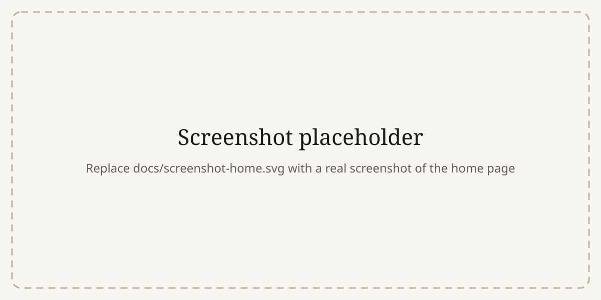
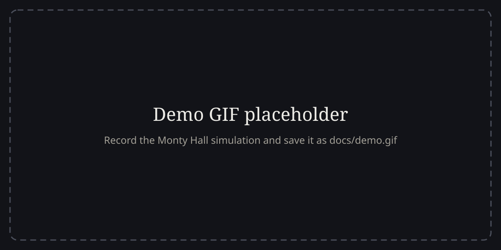

# Paradox Lab

**Interactive explorations of famous paradoxes: arguments that feel wrong, and why.**

Each paradox gets its own small lab. You make a guess, play with the idea (simulations, animations, things to drag and push), and then watch a short captioned explainer video that shows, in plain language, what intuition missed. No equations required. Every paradox is tagged with one of W. V. O. Quine’s three types:

| Type | Meaning | In the lab |
| --- | --- | --- |
| 🟢 **Veridical** | Counterintuitive, but true | Hilbert’s infinite hotel · Rope around the Earth · Monty Hall · Birthday problem · Simpson’s paradox · Banach–Tarski |
| 🟠 **Falsidical** | Seems true, but the argument hides a flaw | Missing square · Missing dollar riddle · Zeno’s dichotomy |
| 🟣 **Antinomy** | A genuine contradiction in logic | Liar paradox · Russell’s paradox & the barber |

**Live demo:** https://kennyshii.github.io/paradox-lab/ <!-- live once GitHub Pages is enabled -->


<!-- TODO: replace with a real screenshot, e.g. docs/screenshot-home.png -->


<!-- TODO: replace with a short GIF (e.g. recorded with Kap or LICEcap) -->

## What’s inside

| Paradox | What you can do |
| --- | --- |
| [Hilbert’s infinite hotel](paradoxes/infinite-hotel/) | Run a full hotel with infinitely many rooms: check in a new guest, a coach, an infinite bus, even infinitely many buses, and watch every guest hop to a new room. Ask any guest where they ended up. |
| [Rope around the Earth](paradoxes/rope-around-earth/) | Drag the sphere radius from a basketball to the Sun and watch the gap stay at ~16 cm. Switch to “pull up at one point” to see the same metre lift the rope ~121 m. |
| [Monty Hall](paradoxes/monty-hall/) | Play the game with 3, 10 or 100 doors, then simulate thousands of rounds and watch stay/switch converge to 1/3 vs 2/3. |
| [Birthday problem](paradoxes/birthday-problem/) | Slide the group size along a live probability curve; sample random groups on a calendar and run a Monte Carlo check. |
| [Simpson’s paradox](paradoxes/simpsons-paradox/) | Toggle groups in the real kidney-stone and Berkeley-admissions datasets and watch the overall trend flip. |
| [Banach–Tarski](paradoxes/banach-tarski/) | Explanation of the proof, with a free-group diagram showing four pieces rebuilding two copies. |
| [Missing square](paradoxes/missing-square/) | Animate the pieces between arrangements, exaggerate the bend, and highlight the half-square slivers. |
| [Missing dollar riddle](paradoxes/missing-dollar/) | Follow all 30 coins between the friends, the hotel and the bellhop, then change the numbers and watch the “missing” dollar come and go. |
| [Zeno’s dichotomy](paradoxes/zeno-dichotomy/) | Take half-steps toward the door, zoom into the remaining gap, then just walk across. Compare with the divergent harmonic series. |
| [Liar paradox](paradoxes/liar-paradox/) | Build self-referential sentences, inspect their truth tables, and watch paradoxical ones flip forever under revision. |
| [Russell’s paradox & the barber](paradoxes/russells-paradox/) | Fill in who shaves whom; then build Russell’s set as the flipped diagonal of a membership table. |

Every page follows the same structure: **statement → guess → interactive lab → “why it works” (a captioned explainer video plus three plain-language takeaways) → type badge and reason → further reading.**

## Tech

- Plain HTML, CSS and JavaScript ES modules. **No build step, no framework, no backend.**
- Charts and diagrams are hand-written SVG and Canvas (a reusable line chart with hover read-outs in [`assets/js/lib/chart.js`](assets/js/lib/chart.js), animated stages in [`assets/js/lib/fx.js`](assets/js/lib/fx.js)).
- Apple-inspired motion: cross-page View Transitions morph a card's artwork into its lab, filters and guesses morph in place, and sections reveal on scroll. Everything respects `prefers-reduced-motion`.
- Every explanation is an animated, captioned explainer video drawn live on a canvas ([`assets/js/lib/explainer.js`](assets/js/lib/explainer.js)), with play/pause, a scrubber, keyboard control and a full transcript.
- Zero third-party code.
- Light and dark themes (follows the OS, with a toggle), keyboard accessible, respects `prefers-reduced-motion`.
- Deploys as-is to GitHub Pages; all paths are relative, so it works under `/paradox-lab/`.

## Run it locally

ES modules don’t load from `file://`, so serve the folder over HTTP:

```bash
cd paradox-lab
python3 -m http.server 8000
```

Then open <http://localhost:8000>. Any static server works (`npx serve`, VS Code Live Server, …).

### Tests

The maths behind each lab lives in pure `model.js` files, tested with Node’s built-in test runner (Node 18+, no install needed):

```bash
npm test
```

## Project structure

```
paradox-lab/
├── index.html                  # home page: filterable card grid
├── assets/
│   ├── css/main.css            # design tokens (light/dark), layout, shared components
│   └── js/
│       ├── page.js             # shared shell: header, hero + badge, guess widget, pager
│       ├── home.js             # home grid + type filter
│       ├── config.js           # site name, repo URL
│       ├── theme-init.js       # applies saved theme before first paint
│       └── lib/
│           ├── chart.js        # responsive SVG line chart
│           ├── sim.js          # Tally, runTrials (non-blocking simulations), tween
│           ├── random.js       # seedable PRNG, randInt, shuffle
│           ├── dom.js          # h(), bindRange, segmented controls, safe storage
│           ├── fx.js           # stageCanvas, morph (view transitions), confetti, countTo
│           ├── explainer.js    # captioned explainer-video player and drawing kit
│           ├── particles.js    # home-page particle morph and per-paradox silhouettes
│           └── format.js       # percentages, lengths, fractions
├── paradoxes/
│   ├── registry.js             # the list of paradoxes: title, type, teaser, reason
│   ├── _template/              # copy this to start a new paradox
│   └── <slug>/
│       ├── index.html          # the page content (statement, guess, lab, explanation, reading)
│       ├── main.js             # wiring: controls → model → drawing
│       ├── model.js            # pure maths/logic, unit-tested
│       ├── style.css           # page-specific styles
│       └── thumb.svg           # card image on the home page
└── tests/                      # node:test suites for the models
```

## Add a new paradox

1. Copy the template: `cp -r paradoxes/_template paradoxes/my-paradox`
2. Set `data-slug="my-paradox"` on `<body>` in `paradoxes/my-paradox/index.html`.
3. Add an entry to [`paradoxes/registry.js`](paradoxes/registry.js) with `slug`, `title`, `type` (`veridical` | `falsidical` | `antinomy`), `teaser` and `reason`.
4. Write the maths in `model.js`, the interaction in `main.js`, and the five content sections in `index.html`.
5. Replace `thumb.svg` (320×180) and add tests in `tests/`.

The home grid, badge, page title and previous/next links all update from the registry automatically. See [CONTRIBUTING.md](CONTRIBUTING.md) for the full checklist and conventions.

## Deploy to GitHub Pages

1. Push the repo to GitHub.
2. **Settings → Pages → Build and deployment → Deploy from a branch**, choose `main` and `/ (root)`.
3. Update `REPO_URL` in [`assets/js/config.js`](assets/js/config.js) and the live demo link above.

The empty `.nojekyll` file tells Pages to serve the files as they are. `404.html` assumes the repo is named `paradox-lab`; edit its three absolute paths if you rename it.

## Why I built this

<!-- TODO: make this your own -->
Paradoxes are the best advertisement for mathematics I know. They start with a feeling that something is *wrong*, and the only way out is to actually understand what’s going on. Reading an explanation of the Monty Hall problem rarely convinces anyone; playing it a hundred times and watching the win rates separate usually does. I wanted a place where each paradox has a lab you can poke at until your intuition updates, and where the explanation is waiting once you’re ready for it.

It was also an exercise in building something polished with zero dependencies: no framework, no bundler, just modules, SVG and careful CSS.

## License

[MIT](LICENSE)
